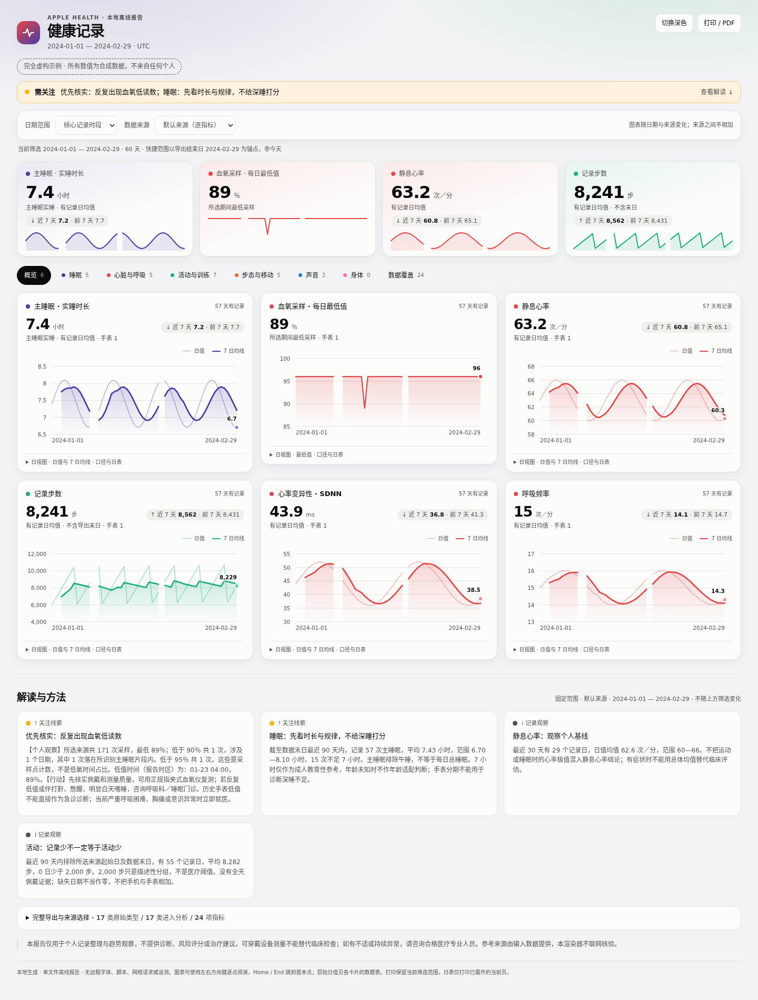
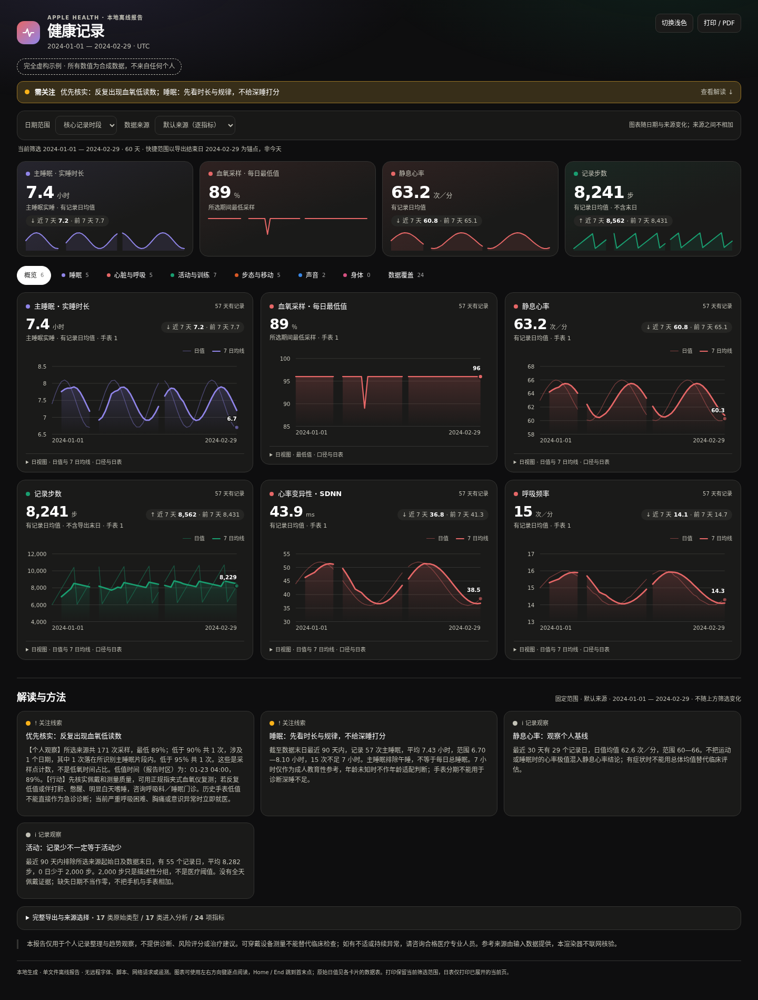
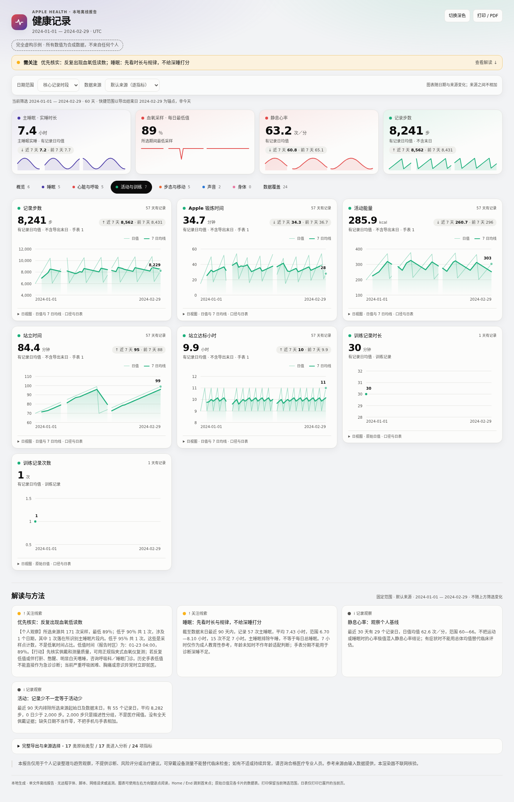
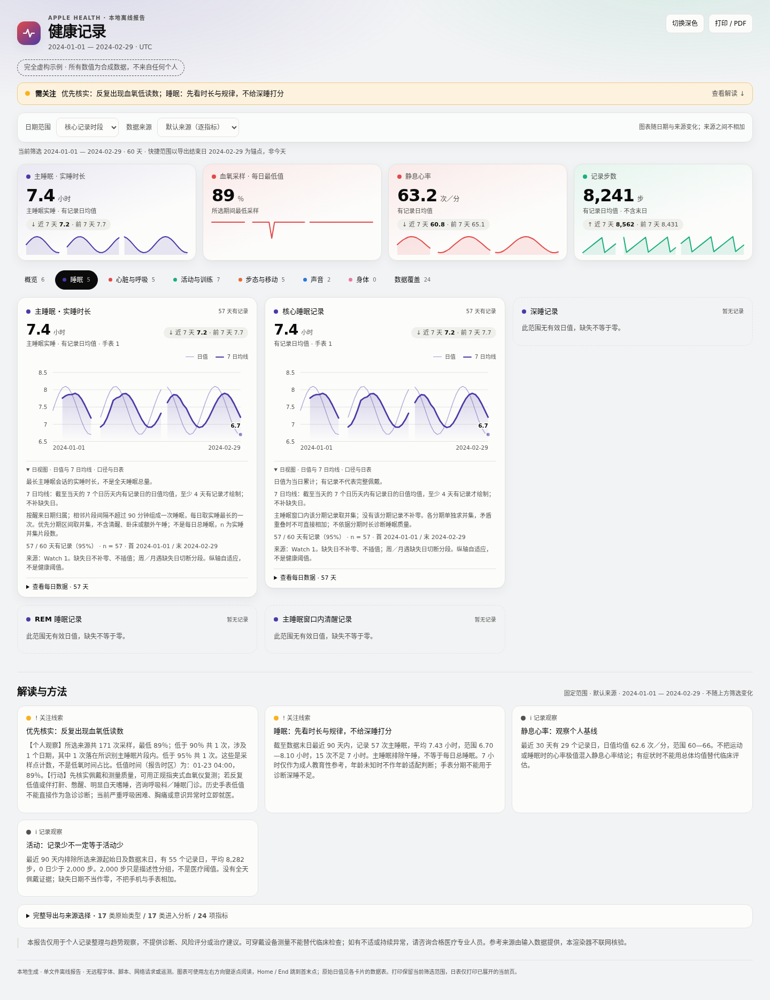
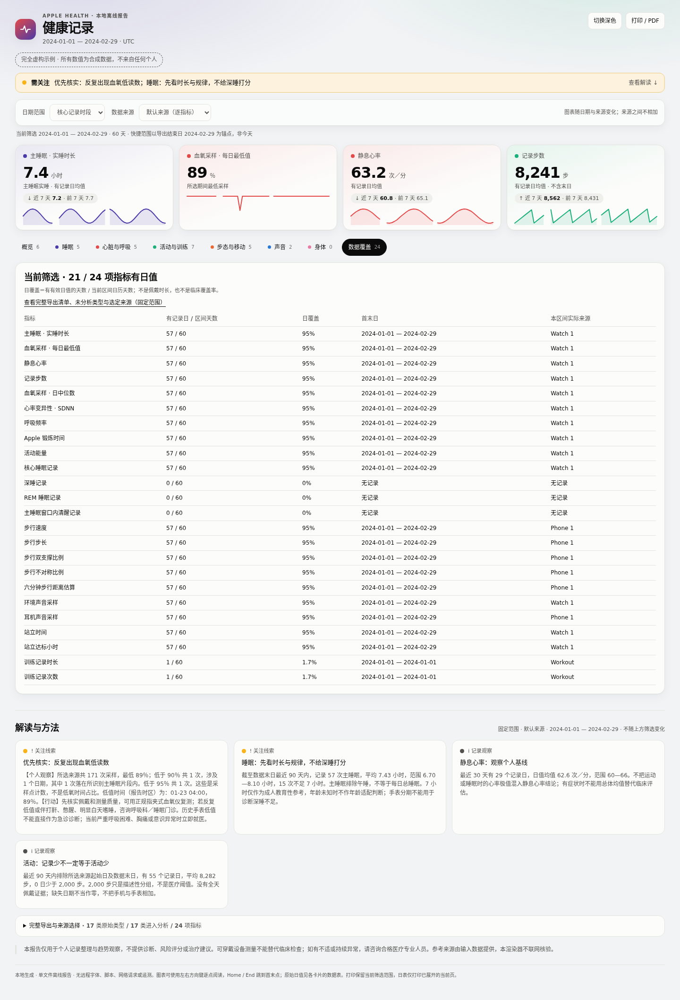
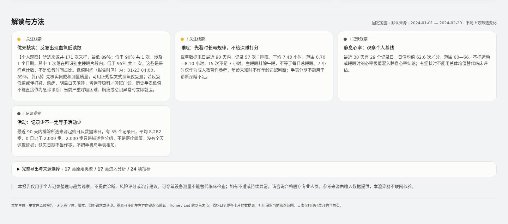
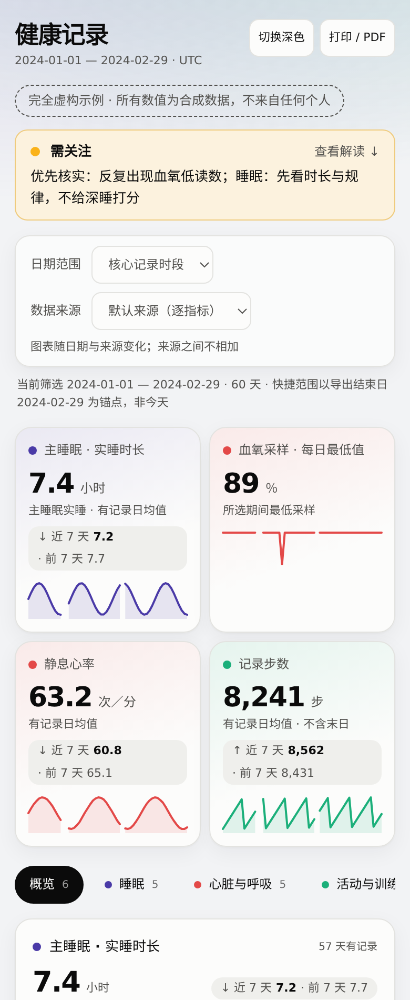
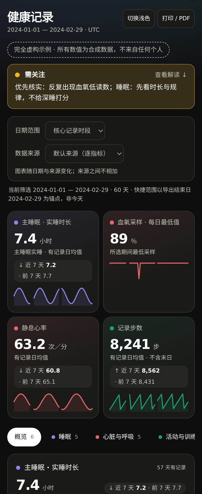

<h1 align="center">Apple Health Analysis</h1>

<p align="center">
  <a href="LICENSE"></a>
  
  
  
</p>

<p align="center"><strong>把苹果健康导出变成一份可解释、可离线打开的交互 HTML 报告</strong></p>

<p align="center">本地处理，无 API Key，无云端上传，无健康评分。可作为 Agent Skill 加载，也可直接用 Python 命令行运行。</p>

<p align="center"><a href="#快速开始">快速开始</a> · <a href="#能做什么">能做什么</a> · <a href="#重要口径">重要口径</a> · <a href="references/methodology.md">方法与局限</a> · <a href="SKILL.md">Skill 工作流</a></p>

<p align="center"><a href="docs/screenshots/overview-light.png"></a></p>
<p align="center">健康看板概览 · 带趋势小图与近 7 天对比的指标卡，日值细线叠加 7 日均线，按分类配色</p>

<details>
<summary>更多截图：深色主题、活动与睡眠分类、数据覆盖、解读与方法、移动端</summary>

<table align="center">
<tr>
<td align="center"><a href="docs/screenshots/overview-dark.png"></a></td>
<td align="center"><a href="docs/screenshots/activity.png"></a></td>
</tr>
<tr>
<td align="center">深色主题</td>
<td align="center">活动与训练 · 步数、锻炼、能量与站立</td>
</tr>
<tr>
<td align="center"><a href="docs/screenshots/sleep-details.png"></a></td>
<td align="center"><a href="docs/screenshots/coverage.png"></a></td>
</tr>
<tr>
<td align="center">睡眠 · 展开口径说明；没有记录的分期排在最后</td>
<td align="center">数据覆盖 · 每项指标的有记录日、首末日与实际来源</td>
</tr>
<tr>
<td align="center" colspan="2"><a href="docs/screenshots/about.png"></a></td>
</tr>
<tr>
<td align="center" colspan="2">解读与方法 · 固定范围的观察、完整导出清单与局限，放在图表之后</td>
</tr>
</table>

<table align="center">
<tr>
<td align="center"><a href="docs/screenshots/mobile-light.png"></a></td>
<td align="center"><a href="docs/screenshots/mobile-dark.png"></a></td>
</tr>
<tr>
<td align="center">移动端 · 浅色</td>
<td align="center">移动端 · 深色</td>
</tr>
</table>

</details>

> 所有截图都来自 `scripts/make_demo.py` 生成的**完全虚构**数据，不来自任何个人。
>
> 这是消费级设备记录的观察性分析工具，不是医疗器械，不提供诊断或治疗建议。未标记异常不等于没有健康问题。

## 能做什么

| 功能 | 说明 |
|---|---|
| **直接读导出** | 读取 Apple Health 的 ZIP 或 XML，不必解压整个压缩包 |
| **覆盖主要指标** | 睡眠与分期、心率、HRV、血氧、呼吸、活动、站立、训练、步态与移动能力、声音采样和身体测量；未支持的类型保留目录计数 |
| **图表优先的单文件看板** | 分类导航、吸顶的日期与来源筛选、日值叠加 7 日均线、指标卡趋势小图与近 7 天对比、悬浮和键盘读数；解读与方法放在图表之后 |
| **来源独立处理** | 手机长期历史与手表近期数据可切换查看，不互相覆盖，也不把步数直接相加 |
| **数据覆盖如实标注** | 区分扫描数、有效处理数、默认来源数与类型支持范围，不把文件记录数当成医学覆盖率 |
| **低值不被掩盖** | 单独展示每日最低血氧采样，避免被中位数掩盖；不推断低氧持续时间 |
| **数据质量检查** | 识别完全重复、覆盖缺口、过期身体资料和多来源情况 |
| **离线、可打印** | 支持明暗主题、窄屏与打印；无 CDN、外部字体、分析追踪或远程图表服务 |

## 快速开始

需要 Python 3.10 及以上，运行时只用标准库。

```bash
python3 scripts/analyze.py /path/to/private/export.zip \
  --output-dir /path/to/private/report \
  --timezone Asia/Shanghai
```

用浏览器打开输出目录中的 `report.html`。`analysis.json` 保存可复核的聚合数据与方法信息。

**输出目录必须在本项目之外。** HTML 和 JSON 都是敏感健康资料，不要上传到公开仓库、公共图床或在线 HTML 预览站。原始文件不会被修改。

### 先看演示

仓库自带一份合成数据报告 [`examples/demo.html`](examples/demo.html)，下载后用浏览器打开即可。也可以自己生成：

```bash
python3 scripts/make_demo.py /tmp/apple-health-demo/export.xml \
  --report /tmp/apple-health-demo/report.html
```

演示生成器只用固定公式，**所有数值完全虚构**。它不读取用户目录，也不从真实数据采样。其中的缺口和一个低血氧样本是故意构造的，不代表任何人的健康情况。

### 安装为 Skill

把完整目录放进所用工具支持的 Skill 目录，例如：

```text
~/.agents/skills/apple-health-analysis/
├── SKILL.md
├── scripts/
└── references/
```

如果工具只读取自己的 Skill 路径，可以在它的入口建一个指向本目录的链接。不要维护多份各自修改的源码副本。

示例请求：

> 分析这个苹果健康导出，在本地生成带图表的 HTML。先看数据覆盖与来源重复，再给最重要的观察和局限。不要上传原始数据。

## 可选参数

| 参数 | 作用 |
|---|---|
| `--timezone` | IANA 时区；不提供则保留记录原始 UTC 偏移 |
| `--config` | 私人 JSON 配置：按指标指定来源，附上本次实际核验的外部参考资料 |
| `--analyze-only` | 只生成 `analysis.json` |
| `--max-xml-mb` | 解压后 XML 的大小上限，默认 2000 MB |

来源配置示例（名称均为虚构）：

```json
{
  "sources": {
    "steps": "Synthetic Watch"
  },
  "references": []
}
```

没有外部资料时仍可生成描述性报告，但不能把自动规则包装成已核验的医疗建议。指南核验不属于离线 Python 运行器，由执行 Skill 的助手完成，并在报告中记录日期和核验范围。

## 重要口径

1. **来源不是越多越好。** 各来源独立聚合，默认每个指标展示一个来源：通常优先 Watch，再比较覆盖天数；耳机声音优先覆盖天数，避免偶发的手表采样压过长期手机记录。这是透明的近似，不是对健康 App 私有合并算法的重建。多来源只切换，不自动拼接。
2. **没有记录不等于零。** 不填补未佩戴日；首尾日期可能不完整。“有记录日均值”不是包含缺失日的日历均值。
3. **主睡眠不等于整日总睡眠。** 分期区间先取并集，再按醒来日期选最长会话；清醒和卧床不算实睡，额外的未分期睡眠另列。
4. **采样不是持续监测。** 血氧只代表采样点，不能用两个低点推算连续低氧。腕温不是核心体温，设备的呼吸紊乱不是临床 AHI。
5. **历史不是现在。** 每个指标有自己的覆盖范围；旧体重不当作当前体重，多年导出不等于多年生命体征监测。

详见 [方法与局限](references/methodology.md) 和 [Skill 工作流](SKILL.md)。

## 安全与隐私

- 默认不读取 GPS、CDA 或身份资料；报告使用通用来源别名，但健康趋势本身仍然敏感。
- 不联网发送数据；外部来源链接只在读者主动点击时打开。
- 不接受 XML 自定义实体；ZIP 不落地解压；拒绝多个不明确的主 XML 和超限成员。
- XML 流式读取，但所支持指标的记录与去重键保留在内存中，超大导出仍需足够内存。
- 发布内容只允许源码、文档、合成 fixture 及其截图；真实报告、聚合 JSON、原始 ZIP/XML、真实截图和私人配置一律排除。
- `.gitignore` 只是辅助，不是保密措施；提交前请检查 `git diff --cached`。

## 开发

```bash
python3 -m unittest discover -s tests -v
```

单元测试只用合成记录，不需要健康导出文件。修改图表后还应在本地浏览器检查桌面、手机、键盘操作和打印。README 截图只能从 `make_demo.py` 生成的合成报告截取，不要提交真实报告的截图。

## 许可

MIT。第三方商标属于各自权利人；本项目与 Apple 没有隶属或认证关系。
